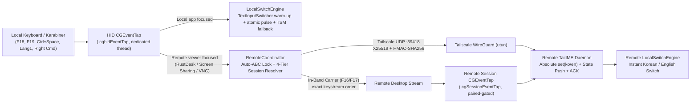

# TailIME

**Zero-lag Korean/English switching across macOS and Windows over Tailscale — locally on macOS and bidirectionally across Mac ↔ Mac, Mac ↔ Windows, and Windows ↔ Windows remote desktop sessions (RustDesk, RDP / Windows App, Screen Sharing, VNC, Parsec). Zero dependencies. No telemetry.**

**English** | [한국어 (Korean Guide)](README.ko.md)

[](https://github.com/wmyung/tailime/releases/latest)
[](https://github.com/wmyung/tailime/releases/latest)
[](#architecture)
[](#build-from-source)
[](./LICENSE)
[](https://github.com/wmyung/tailime/releases/tag/v1.1.0)

---

**TailIME** is a lightweight native utility for **macOS** (Swift + AppKit) and **Windows** (Go + Win32) built to end two chronic headaches for Korean users:

1. **Sluggish local switching & dropped first characters (macOS)** — macOS switches on key-up (causing rollover typos like `한dud` → `하dud`), and macOS 26+ kills `com.apple.TextInputSwitcher` under memory pressure so the first switch press after idle does nothing.
2. **Broken Korean/English switching over remote desktop (Mac ↔ Mac, Mac ↔ Windows, Windows ↔ Windows)** — when controlling a remote Mac or Windows PC over Tailscale via RustDesk, RDP / Windows App, Apple Screen Sharing, VNC, Jump Desktop, or Parsec, your local OS or Karabiner intercepts the switch key, Translate vs Map mode breaks Hangul composition, or local Hangul IME hijacks keystrokes meant for the remote host.

Install `TailIME` on both machines (macOS or Windows), pair in 10 seconds with a 6-digit SAS code or `TKP1` token, and keep your existing Karabiner, macOS, or Windows keyboard settings completely untouched.

---

## Direct Download (`v1.1.0`)

### macOS (Universal `arm64` + `x86_64`)
- **Installer (`.pkg`):** **[TailIME-1.1.0-macos.pkg](https://github.com/wmyung/tailime/releases/download/v1.1.0/TailIME-1.1.0-macos.pkg)** ([SHA-256](https://github.com/wmyung/tailime/releases/download/v1.1.0/TailIME-1.1.0-macos.pkg.sha256))
- **Disk Image (`.dmg`):** **[TailIME-1.1.0-macos.dmg](https://github.com/wmyung/tailime/releases/download/v1.1.0/TailIME-1.1.0-macos.dmg)** ([SHA-256](https://github.com/wmyung/tailime/releases/download/v1.1.0/TailIME-1.1.0-macos.dmg.sha256))
- **Portable Archive (`.zip`):** **[TailIME-1.1.0-macos.zip](https://github.com/wmyung/tailime/releases/download/v1.1.0/TailIME-1.1.0-macos.zip)** ([SHA-256](https://github.com/wmyung/tailime/releases/download/v1.1.0/TailIME-1.1.0-macos.zip.sha256))

```bash
unzip TailIME-1.1.0-macos.zip
cd TailIME-1.1.0
./install.sh --link-cli
```

### Windows 10 / 11 (`x64`)
- **GUI Installer (`.exe`):** **[TailIME-1.1.0-windows-x64-setup.exe](https://github.com/wmyung/tailime/releases/download/v1.1.0/TailIME-1.1.0-windows-x64-setup.exe)** ([SHA-256](https://github.com/wmyung/tailime/releases/download/v1.1.0/TailIME-1.1.0-windows-x64-setup.exe.sha256))
  - Installs to `%LOCALAPPDATA%\TailIME\`, adds Start Menu shortcut, auto-start, Installed Apps uninstall entry, User `PATH` (`tailime-ctl.exe`), and offers a scoped Windows Defender Firewall rule (UDP `39418` restricted to Tailscale `100.64.0.0/10` and `fd7a:115c:a1e0::/48` only).
- **Portable Archive (`.zip`):** **[TailIME-1.1.0-windows-x64.zip](https://github.com/wmyung/tailime/releases/download/v1.1.0/TailIME-1.1.0-windows-x64.zip)** ([SHA-256](https://github.com/wmyung/tailime/releases/download/v1.1.0/TailIME-1.1.0-windows-x64.zip.sha256))

```powershell
# PowerShell install from portable ZIP (removes Mark-of-the-Web automatically)
powershell -ExecutionPolicy Bypass -File .\install.ps1 -AddFirewall
```

> **Note on unsigned open-source builds:**
> - **macOS:** Ad-hoc signed — right-click → **Open** (or allow under **System Settings → Privacy & Security**) on first run, or run `./install.sh --link-cli`.
> - **Windows:** Unsigned — if Windows SmartScreen warns on first launch, click **More info → Run anyway** (or inspect/build from `windows/` with Go 1.27+).
> - **Existing settings:** `TailIME` **never modifies** `~/.config/karabiner/karabiner.json` or `com.apple.symbolichotkeys`.

---

## Why Hybrid Two-Channel Remote Sync?

Remote desktop keystreams (TCP/QUIC) and out-of-band UDP packets travel different queues. Sending a naive UDP "toggle" races ahead of or behind rapid typing (`안녕` + `<switch>` + `hello` turns into `안녀d` or `ㅗello`) and double-toggles on retry.

`TailIME` combines **two channels** and sends **absolute target states (`ko` / `en`)** instead of non-idempotent toggles:

| | In-Band Carrier Channel | Tailscale Authenticated UDP Channel |
|---|---|---|
| **Role** | Exact keystream ordering when supported (e.g. RustDesk Map/Legacy, Screen Sharing) | Real-time language state push, 6-digit SAS pairing, auto-probe, and instant execution when carrier keys are filtered (e.g. RustDesk Translate) |
| **Payload** | Conflict-free unused F-key pair (`F16` = Korean, `F17` = English), injected synchronously in the HID event tap | Compact `TIV1` UDP packet over Tailscale WireGuard, authenticated with per-peer HKDF-SHA256 HMAC |
| **Ordering** | Arrives at the exact character boundary inside the remote keystream — even over 200ms DERP relay | Adaptive FIFO `HoldGate` on direct Tailscale paths + strict monotonic sequence ordering (stale older commands rejected) |
| **Double-toggle risk** | ❌ None (absolute target + remote anti-leak guard) | ❌ None (absolute target + idempotent cached ACK) |

---

## Comparison with Alternatives

| Feature | **TailIME** | `gksdud` | `HangulSync` | Karabiner + RustDesk Map Mode | macOS Built-in |
|---|---|---|---|---|---|
| **Zero-delay local `keyDown` switching** | ✅ Yes | ✅ Yes | ❌ No | ❌ Key-up delay | ❌ Key-up / Caps delay |
| **macOS 26+ `TextInputSwitcher` warm-up** | ✅ Automatic | ✅ Automatic | ❌ No | ❌ No | ❌ Drops first press |
| **Works without touching Karabiner** | ✅ Read-only auto-detect | ⚠️ HID conflict risk | ✅ Yes | ⚠️ Manual per-device rules | ✅ Yes |
| **Remote Mac over Tailscale (RustDesk Map & Translate)** | ✅ Both modes | ❌ Local only | ⚠️ Local IME collision | ❌ Breaks in Translate & Karabiner | ❌ Local intercepts key |
| **Auto-ABC lock on remote window focus** | ✅ Yes (prevents jamo split) | ❌ No | ❌ Mirrors both Macs | ❌ Manual | ❌ No |
| **In-band keystream ordering + UDP fallback** | ✅ Auto-hybrid | ❌ No | ❌ TCP mirror only | ❌ Key-only | ❌ No |
| **Unpaired / Windows remote fallback** | ✅ Safe OS-aware fallback | ❌ No | ❌ Mac-to-Mac only | ⚠️ Manual Right Alt | ❌ No |
| **CJK TSM direct switch fallback (`macism`-style)** | ✅ Built-in | ✅ Helper process | ❌ `TISSelectInputSource` only | ❌ No | ❌ Native only |
| **Runtime dependencies** | **Zero** (Native Swift) | Zero (Native Swift) | Zero (Native Swift) | Karabiner DriverKit | Built-in |

---

## Architecture



### Universal Trigger Compatibility (Zero Config Needed)

- **macOS System Hotkey `60`** (`Select the previous input source`): Auto-detected read-only. Preserves Hotkey `61` and 3+ input source semantics untouched.
- **Karabiner-Elements**: Watches `~/.config/karabiner/` directory (survives atomic file replacement) and auto-detects per-device `simple_modifications` and `complex_modifications` (`Right Cmd → F18`, `Right Opt → F19`, `Caps Lock → Ctrl+Space`, etc.).
- **Hardware Hangul (`Lang1`) & Custom Keys**: Built-in **Key Recorder** in Settings captures any key, shortcut, or standalone modifier tap (`Right Command` / `Right Option` / `Right Control`).
- **Optional Non-Karabiner HID Remapper**: Opt-in physical-keyboard-only `UserKeyMapping` (OFF by default, automatically locked if Karabiner is running).

---

## Quick Start (2 Minutes)

### 1. Install on Both Machines (macOS & Windows)

- **macOS:** Run **[TailIME-1.1.0-macos.pkg](https://github.com/wmyung/tailime/releases/download/v1.1.0/TailIME-1.1.0-macos.pkg)**, drag from **[TailIME-1.1.0-macos.dmg](https://github.com/wmyung/tailime/releases/download/v1.1.0/TailIME-1.1.0-macos.dmg)**, or run `./install.sh --link-cli` from `TailIME-1.1.0-macos.zip`, then grant **Accessibility** permission under **System Settings → Privacy & Security → Accessibility → TailIME**.
- **Windows 10/11:** Run **[TailIME-1.1.0-windows-x64-setup.exe](https://github.com/wmyung/tailime/releases/download/v1.1.0/TailIME-1.1.0-windows-x64-setup.exe)** (or `powershell -ExecutionPolicy Bypass -File .\install.ps1 -AddFirewall` from the portable ZIP) and approve the Tailscale-scoped UDP `39418` firewall rule when prompted.

> **Developer Tip (Keep Accessibility Permission Across Rebuilds):** Run `./scripts/setup-local-cert.sh` once to create a local code-signing certificate in your Login Keychain, then build with `CODESIGN_IDENTITY="TailIME Local Signing" ./scripts/package-dist.sh`.

### 2. Pair Your Macs Over Tailscale (10 Seconds)

Open the menu bar icon (`한` / `EN`) → **설정 → 원격 Tailscale**:

- **Option A — Direct 6-Digit SAS Pairing**
  1. Select your remote Mac from the auto-discovered Tailscale peer list and click **직접 페어링 요청**.
  2. Both Macs immediately exchange Curve25519 public keys and display the exact same **6-digit SAS code** (`123-456`).
  3. Confirm both codes match and click **승인 및 신뢰** on both Macs.
  4. Click **연결 테스트(Ping)** to confirm direct RTT (typically `1–5 ms` on LAN/Direct Tailscale).

- **Option B — Copy/Paste Token (Convenient Inside a Remote Session)**
  1. Click **내 페어링 토큰 복사** on Mac A → paste into **상대 토큰 붙여넣기** on Mac B.
  2. Repeat from Mac B → Mac A.

### 3. Use Normally

- Focus any local app → press your usual Korean/English key → instant `keyDown` switch.
- Focus **RustDesk**, **Apple Screen Sharing**, **TigerVNC**, **Jump Desktop**, **Parsec**, **Moonlight**, **NoMachine**, or **AnyDesk**:
  - Local Mac automatically locks to **English (ABC)** so local Hangul IME never garbles remote typing.
  - Press your usual local Korean/English key → remote Mac switches instantaneously (`⚡한` / `⚡EN` in menu bar + subtle non-focus-stealing mini HUD).
  - Unpaired or Windows peers automatically use safe OS-aware fallback (`Right Option` for Windows Map mode; never injects `Shift+Space` unless explicitly selected).

---

## CLI (`tailime-ctl`)

```bash
tailime-ctl status                          # Local/remote state, permissions, detected triggers
tailime-ctl toggle                          # Fast local toggle
tailime-ctl set ko                          # Deterministic local switch to Korean
tailime-ctl set en                          # Deterministic local switch to English
tailime-ctl peers                           # Tailscale peers & TailIME daemon reachability
tailime-ctl remote-set 100.64.0.10 ko       # Deterministic remote Mac switch over Tailscale
tailime-ctl pair-export                     # Print your TKP1 pairing token
echo "TKP1:..." | tailime-ctl pair-import   # Register peer token via stdin (kept out of argv)
tailime-ctl pause                           # Temporarily pause interception
tailime-ctl resume                          # Resume interception
tailime-ctl quit                            # Quit TailIME cleanly
```

---

## Security & Privacy Model

- **Zero Telemetry / Zero Cloud Relay**: All remote traffic stays strictly inside your Tailscale WireGuard Tailnet.
- **No `0.0.0.0` Binding**: UDP listener (`39418`) binds exclusively to your Tailscale IPv4 (`100.64.0.0/10`), Tailscale IPv6 (`fd7a:115c:a1e0::/48`), and `127.0.0.1`.
- **Kernel Interface Verification**: Incoming packets are checked via `IP_RECVIF` / `IPV6_PKTINFO` to ensure arrival on `utun*` (or `lo*` for loopback self-tests) and verified against `tailscale status` / `tailscale whois`.
- **Per-Peer Cryptography**: Each Mac generates a persistent `Curve25519` identity in macOS Keychain (`kSecAttrAccessibleAfterFirstUnlockThisDeviceOnly`) and derives a unique per-peer 256-bit HMAC key via `HKDF-SHA256`, verified in constant time via CryptoKit.
- **Replay & Order Protection**: Monotonic 64-bit sliding-window replay guard per `(deviceID, bootSessionID)` with strict latest-sequence enforcement for state-mutating commands and `(deviceID, sourceIP, nonce, replyToSeq)` ACK binding.
- **Zero Keystroke Storage**: Typed text is never logged or persisted. The Diagnostics monitor only displays transient keyCode/modifier metadata while the Diagnostics tab is explicitly open.

---

## Troubleshooting

### 1. Pressing the switch key inside RustDesk / Screen Sharing does not switch the remote Mac
- **Check Accessibility on BOTH Macs:** Run `tailime-ctl status` on both Macs and verify `accessibility: true`, `hidTap: true`, and `sessionTap: true`.
- **Check Tailscale pairing & reachability:** Run `tailime-ctl peers` and confirm the remote Mac shows `daemonReachable: true`. If not, pair both Macs under **Settings → 원격 Tailscale** (6-digit SAS or `TKP1` token exchange).
- **Check the menu bar indicator:** When focused on RustDesk/Screen Sharing, the menu bar should show **`⚡한`** / **`⚡EN`**. If it shows plain `한`/`EN`, TailIME hasn't matched the remote window yet — select the remote Mac manually from **Menu Bar → 원격 대상 Mac 선택**, or verify Tailscale Direct IP is enabled in RustDesk.
- **Quit competing IME switchers:** Running **`gksdud`**, **`HangulSync`**, **Input Source Pro**, or **Kawa** alongside TailIME causes `CGEventTap` conflicts (the competing app can swallow `F18`/`F19` before TailIME sees it). Check `conflictingApps` in `tailime-ctl status` or the **Diagnostics** tab and quit competing utilities.

### 2. Pressing the switch key triggers unexpected shortcuts (window maximize, Dock focus, etc.)
- **Update both Macs to `v1.0.1` or later:** `v1.0.1` eliminates synthetic `maskSecondaryFn` (`Fn/Globe`) modifier latching on `keyUp` and uses **Tailscale UDP Direct** by default (never injecting synthetic `F16`/`F17`/`F20` keys into RustDesk, whose `rdev`/`enigo` macOS keycode translation can mis-map extended F-keys).
- **Recommended transport setting for RustDesk:** Keep **Settings → 원격 Tailscale → 전송 방식** set to **Tailscale UDP 직접 전송 (권장 · RustDesk 안전)**.
- **If `Fn/Globe` was stuck from `v1.0.0`:** Tap the physical `Fn (Globe)` key once on each Mac, then update to `v1.0.1` or later.

### 3. Custom switch keys (`Left/Right Control`, `Ctrl+Space`, `Cmd+Space`, `Shift+Space`, `Caps Lock`, Karabiner `to_if_alone`) are not detected
- Open **Settings → 한영키** and either pick a preset (supports all left/right `Control`, `Option`, `Command`, `Shift` standalone taps and `*+Space` combos) or click **한영키 직접 녹화...** to capture your exact key.
- For macOS native **`Caps Lock (한/A)`**, confirm *System Settings → Keyboard → Input Sources → Use the Caps Lock key to switch to and from ABC* is enabled and not overridden by Karabiner.
- **Secure Input active:** When a password field (`sudo` in Terminal, 1Password, login prompt) enables macOS Secure Input, macOS blocks all event taps by design. TailIME displays the blocking app in the menu bar and **Diagnostics** tab — close that prompt to resume automatically.

### 4. Pairing drops or Accessibility stops working after updating / rebuilding
- **Keychain prompt on ad-hoc upgrade:** Because ad-hoc builds (`codesign --sign -`) change their code signature hash on update, macOS Keychain prompts to allow access to the stored `com.tailime.app.identity` key. Click **Always Allow**.
  - **On `v1.0.2` and later:** If you accidentally cancel or deny that prompt, TailIME **never overwrites** your stored Keychain key. Instead, it displays a warning banner in the menu bar and **Settings → 일반** (`identityPersistent: false` in `tailime-ctl status`) and pauses pairing/HMAC traffic until you click **키체인 다시 읽기** and choose **Always Allow** — restoring all existing pairings without re-pairing.
  - **If upgrading from `< v1.0.2` after a key rotation:** Earlier builds rotated the key on Keychain denial, leaving a key mismatch (`daemonReachable: false`). To recover, allow Keychain access, click **신뢰 기기 초기화** on both Macs under **Settings → 원격 Tailscale** *(note: this clears the entire trusted-peer list, so any other paired Macs will also need to be re-paired)*, and re-exchange pairing tokens or re-pair via 6-digit SAS.
- **Accessibility TCC cache:** Even if the toggle appears ON after replacing an ad-hoc build, macOS TCC may keep the old signature hash. Open **System Settings → Privacy & Security → Accessibility**, select `TailIME`, click **`-`** to remove it, then click **`+`** to re-add `/Applications/TailIME.app`.
- **Reducing permission resets across rebuilds:** Run `./scripts/setup-local-cert.sh` once and build with `CODESIGN_IDENTITY="TailIME Local Signing" ./scripts/package-dist.sh`. Signing with a persistent local certificate helps preserve Keychain ACL and Accessibility grants across future updates once granted to the signed build.

### 5. Korean characters split into uncomposed Jamo (`ㄹㅣㄷㅡㅁㅣㅇㅔ`) on the remote Mac
- **macOS `KoreanIM` (`KIM_Extension`) focus mismatch (seen in Electron / Chromium apps):** macOS 2-Set Korean combines a keyboard layout (`2SetHangul`) with the `KoreanIM` composition server (`KIM_Extension`). If a floating window on the remote Mac (such as RustDesk's incoming connection bar `RustDesk --cm`) briefly takes key focus during a language switch, `TextInputSwitcher` can hit a `target app and typing focus mismatch` — leaving the target Electron/Chromium app (VS Code, Antigravity, Slack, Chrome) on raw `2SetHangul` without `KIM_Extension` attached.
  - **Built-in mitigation (`v1.0.2+`):** When `CPSGetKeyFocusProcess` and `frontmostApplication` PIDs differ during Korean activation, `TailIME` routes directly through `TSMDirectBridge` off the main thread to both candidate PIDs (with a 25ms TIS verification check); on the standard hotkey-pulse path, the fallback verification window is raised to 150ms to accommodate cold `TextInputSwitcher` wakeups.
  - **Quick recovery:** If an existing session is already stuck on uncomposed Jamo, try pressing `Cmd+Tab` away and back (or clicking another window and back into the text box), or toggling Korean/English once to re-attach `KIM_Extension`. Minimizing RustDesk's floating incoming-connection window (`--cm`) on the remote Mac can also help reduce focus conflicts.
- **RustDesk keyboard mode:** In **Translate mode**, RustDesk may inject characters via `CGEventKeyboardSetUnicodeString`, which can bypass macOS `KoreanIM` syllable composition. Switch RustDesk's toolbar keyboard icon to **Map mode** (and if needed, try toggling macOS **Input Source 1 / 2** in the same menu) while keeping TailIME's **Auto-English (ABC) lock on remote focus** enabled.

### 6. Windows-Specific Troubleshooting (Firewall, UIPI, Korean Keyboard)
- **Windows Defender Firewall blocking UDP `39418` (`daemonReachable: false`):** Re-run the installer and approve the firewall prompt, or run in an **Administrator PowerShell**:
  ```powershell
  netsh advfirewall firewall delete rule name=all program="$env:LOCALAPPDATA\TailIME\TailIME.exe"
  netsh advfirewall firewall add rule name="TailIME (Tailscale UDP 39418)" dir=in action=allow protocol=UDP localport=39418 remoteip=100.64.0.0/10,fd7a:115c:a1e0::/48 program="$env:LOCALAPPDATA\TailIME\TailIME.exe" profile=any enable=yes
  ```
- **Elevated / Administrator window on Windows (`elevationBlocked: true`):** Windows UIPI prevents a standard-privilege `TailIME.exe` from switching IME inside an elevated Administrator window (e.g. Admin PowerShell or elevated Task Manager). Run `TailIME.exe` as Administrator if you need switching inside elevated windows.
- **101-key English vs 103/106-key Korean keyboard on Windows:** Korean 103/106 layouts map Right Alt to `VK_HANGUL (0x15)`; English 101 layouts send `VK_RMENU (0xA5)`. Both are enabled by default in **TailIME Settings**, and standalone Right Alt taps suppress Windows menu-bar focus automatically.
- **macOS `v1.1.0` Mac App Store Tailscale & direct IP pairing:** Even if the `tailscale` CLI is missing or sandboxed (common with Mac App Store Tailscale), `v1.1.0` discovers your local `utun*` Tailscale IPv4/IPv6 directly via `getifaddrs()`, binds UDP `39418` on that IP, accepts HMAC-authenticated peers without requiring CLI lookup, retries `pairHello` / `ping` automatically across cold WireGuard handshakes, and lets you enter any peer's `100.x.y.z` IP directly in **Settings → 원격 Tailscale → 직접 IP**.
- **macOS `v1.1.0` non-blocking Keychain startup:** `v1.1.0` starts `tailime-ctl` IPC, menu bar, and local switching *before* reading Keychain asynchronously, so a buried macOS Keychain dialog on ad-hoc upgrades never causes `tailime-ctl status` to report "not running".

### 7. Fast 10-Second Diagnostic Checklist
```bash
tailime-ctl status   # Verify permissions/hook, identityPersistent, triggers, boundUDP, remoteFocused
tailime-ctl peers    # Verify Tailscale macOS & Windows peers online, direct path, and daemonReachable
```
Or open **Menu Bar / System Tray → 진단 및 실시간 키 테스트... / 설정 및 페어링...** to inspect status and copy a sanitized diagnostic summary.

---

## Build From Source

- **macOS:** macOS 13+ and Xcode Command Line Tools (`xcode-select --install`) — full Xcode.app is not required.
- **Windows (cross-compiled from macOS or built natively on Windows):** Go 1.27+ (`CGO_ENABLED=0`, zero external modules).

```bash
git clone https://github.com/wmyung/tailime.git
cd tailime

# Run all 24 macOS Swift tests & Go Windows core/coordinator tests
swift run tailime-test
(cd windows && go test ./...)

# Build macOS (.pkg + .dmg + .zip) AND Windows (-setup.exe + .zip) installers
./scripts/package-all.sh
```

Outputs are written to `dist/`:
- `dist/TailIME-1.1.0-macos.pkg`, `dist/TailIME-1.1.0-macos.dmg`, `dist/TailIME-1.1.0-macos.zip`
- `dist/TailIME-1.1.0-windows-x64-setup.exe`, `dist/TailIME-1.1.0-windows-x64.zip`

---

## Acknowledgements

TailIME stands on the shoulders of excellent open-source macOS input engineering:

- [`codingnoye/gksdud`](https://github.com/codingnoye/gksdud) — `keyDown` synthetic pulse & macOS 26 `TextInputSwitcher` wake-up insights
- [`catgarret/HangulSync`](https://github.com/catgarret/HangulSync) — Tailscale remote Korean sync & Curve25519 SAS pairing inspiration
- [`laishulu/macism`](https://github.com/laishulu/macism) — `com.apple.tsm.portname` direct CJK switching technique
- [`mark-made/imeguard`](https://github.com/mark-made/imeguard) — remote server `eventSourceUnixProcessID` filtering & local signing workflow

## License

[MIT](./LICENSE) © 2026 wmyung
